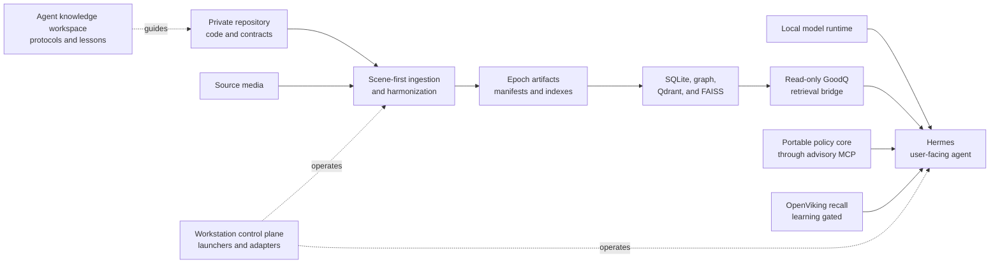

<!-- DOC_BADGE: OPERATIONAL -->
<!-- DOC_STATUS: TIMELESS_AGENT_OVERVIEW -->
<!-- DOC_LAST_VERIFIED: 2026-11-06 -->
<!-- INSTRUCTION_REVIEW: documentation only; no runtime qualification -->

# GoodQ Project Orientation

Read this for unfamiliar, cross-component or authority-sensitive work. It owns
durable topology and evidence boundaries, not current services or a work queue.
For a resumed milestone, read [PROJECT.md](../../PROJECT.md). Use the relevant
row of the [repository map](../architecture/REPOSITORY_MAP.md) for source,
contract and test navigation; the [roadmap](../releases/ROADMAP.md#personal-daily-use-completion-2026-10-07)
owns remaining gates. Read each owner once as needed, without recursive preload.

## One project, separate owners

| Logical root | How to resolve it | Durable responsibility |
|---|---|---|
| `<repo_root>` | Private `goodq4all` development checkout | Product source, tests, contracts, migrations, and repository agent policy |
| `<data_root>` | `GOODQ_DATA_ROOT` through the config loader | Source media, epoch stores, model assets, Qdrant storage, and durable runtime artifacts |
| `<tools_root>` | `%SYSTEMDRIVE%\Tools` on the primary workstation | Machine launchers, Hermes runtime, model serving, MCP adapters, local utilities, logs, and recovery material |
| `<hermes_home>` | `HERMES_HOME`, normally beneath `<tools_root>` | User-facing agent configuration, sessions, skills, and local memory-provider wiring |
| `<portable_agent_root>` | Discover the `goodq_agent` checkout by repository identity | Portable policy/preflight package intended for later desktop/laptop alignment |
| `<agent_knowledge_root>` | Resolve `%SYSTEMDRIVE%\Tools\AGENT_TRAINING.lnk`; never assume its backing drive | Shared protocols, workflows, host profiles, lessons, and reusable operating doctrine |

GOOD-CUBE owns canonical development and data. A follower or public release
checkout does not become a second product authority. Workstation integration
and shared agent doctrine have their own owners; do not copy their implementation
into GoodQ or treat an upstream tools repository as product policy.

## Evidence and authority

| Question | Use |
| --- | --- |
| What behavior is intended? | Current private source, focused tests and canonical subsystem contracts |
| What happened in a run? | Its attributable manifests, logs, receipts and persisted stores |
| What is running now? | Relevant current process, listener, resolved config and bounded read-only probes |
| What may I do? | Current user direction, applicable platform rules and scoped `AGENTS.md`; workflows stay within that authorization |
| What remains? | `PROJECT.md` checkpoint and roadmap gates, reconciled with later evidence |

Keep source changes, deployment, runtime behavior, persisted outcomes and release
clearance distinct. Passing tests do not qualify a historical ingestion or a live
service. A readable context pack, matching version label or populated store is
insufficient without matching source/configuration, epoch, run and owner.

`CURRENT_STATE.md`, `current_state.json` and the RAG pack are generated evidence
projections with capture dates. They are not startup reading, mission owners or
permission to repeat work. Regenerate them through their owner only when a new
capture is in scope; never hand-edit or redate old evidence. A public
`unconfigured_template` has observed no runtime or personal corpus. Pre-reset
corpus reports, session transcripts, model memory and old next steps remain
historical; use the [ingestion failure modes](../reference/INGESTION_FAILURE_MODES.md)
for relevant distilled lessons, not as confirmed current defects.

## System relationship

Arrows show interfaces, not mutation permission. Preserve these boundaries:

- The data root is durable memory, not scratch. Cleanup, re-ingestion,
  re-promotion or reorganization needs exact targets, recovery evidence and
  explicit scope approval. A `tmp` name or large size does not make data disposable.
- The repository owns ingestion and persistence. Canonical UCF source is under
  `scripts/ucf/`. Workstation adapters must not silently mutate canonical stores.
- Hermes reads GoodQ through a bounded read-only bridge. The governor MCP is
  advisory and non-executing. Portable-agent packaging must compare actual
  contract assets; equal versions alone do not prove alignment.
- OpenViking supplies recall. Normal GoodQ sessions remain read-only unless
  learning is explicitly enabled for the process. Recall is not policy,
  configuration, persisted pipeline truth or user authorization.
- Human confirmation governs identity promotion. Model guesses, face review and
  voice review are not interchangeable evidence; use the identity/HITL contracts.
- Context7 `/goodq02/goodq4all` indexes downstream public `main`, not private
  development. If used, resolve the library and record `state`/`lastUpdateDate`;
  stale or conflicting content yields to private source and canonical contracts.

## Resume without repeating work

Establish the requested outcome, its owner, applicable instructions, branch and
local changes. Read the relevant checkpoint/contract and use the smallest probe
that resolves material uncertainty. A documentation edit needs no personal-store
query or service start. For runtime changes, distinguish completed, configured
and unproven scope before proposing another run; do not repeat a broad workflow
to reconstruct context.

Preserve unrelated worktrees and staging. Their checked-in policy is a branch
snapshot; before destructive Git or governance actions, compare it with current
private policy and stop on disagreement. Do not reset/delete to reconcile it.
Private fixes precede public release, which remains a separately authorized gate.

Leave the outcome, evidence, unverified limits and exact next step in the existing
task/checkpoint owner. Link contracts and receipts; do not create another handoff
template, mission or architecture document. Update this orientation only for
durable ownership or boundary changes.
