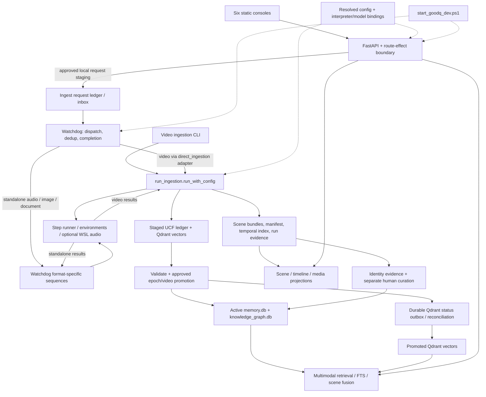

<!-- DOC_BADGE: CANONICAL -->
<!-- DOC_STATUS: AUTHORITATIVE -->
<!-- DOC_LAST_VERIFIED: 2026-11-11 -->

# GoodQ repository architecture map

This is the canonical starting map for understanding the private repository.
It owns source navigation and component relationships; the linked subsystem
contracts own detailed behavior. It introduces no new runtime policy.

**Evidence boundary:** the initial source-navigation review began on private
`dev` at base commit `2c13cec6e8b11a74bbbdbf3cf63a88b8851dd76e`.
Later ownership updates are reflected below; [PROJECT.md](../../PROJECT.md) and
the [roadmap](../releases/ROADMAP.md) record their bounded repair evidence.
This is a static architecture map, not a runtime, corpus, release, or
whole-codebase correctness certificate. Tests named below are drilldown targets,
not a claim that they were run during a documentation pass.

## Context to retain

- GoodQ is a local-first multimodal memory system whose main memory unit is a
  **scene**. Private `dev` owns product behavior; the public release is downstream.
- The repository owns code, tests, contracts and packaging. `GOODQ_DATA_ROOT`
  resolves durable data separately. Workstation integration and Hermes live
  outside this repository; see [project orientation](../agent/PROJECT_ORIENTATION.md).
- **Video:** CLI or watchdog -> `cli.run_ingestion.run_with_config` -> scene
  workers -> scene bundles -> Phase 6 vectors and temporal harmonization.
  The direct-ingestion pipeline is an adapter. Standalone audio/image/document
  ingestion follows separate watchdog methods and shared workers.
- **Memory lifecycle:** isolated ingest stages artifact/UCF/vector evidence;
  validation and separately approved promotion materialize active SQLite/KG.
  Qdrant lifecycle delivery has its own durable recovery obligation.
- **Retrieval:** the main multimodal engine combines text/visual/audio candidates,
  FTS, scene fusion and contextual ranking. The main engine filters Qdrant
  candidates to promoted evidence; SQLite retrieval depends on materialized views.
- **Surfaces:** FastAPI serves six static consoles and guarded API operations.
  Search can write telemetry, so retrieval is not universally passive.
- **Execution:** config, interpreter bindings, model clients, subprocess workers,
  and the API/watchdog supervisor are separate owners. A configured capability
  or present file does not establish a healthy running capability.
- **Completion:** [PROJECT.md](../../PROJECT.md) records the current bounded
  checkpoint; the [roadmap completion view](../releases/ROADMAP.md#personal-daily-use-completion-2026-10-07)
  owns remaining gates and work order. Reconcile the selected item with source
  and evidence. Generated current-state documents retain their capture dates.
  Historical open items, past test counts and deferred features are not a
  reliable completion percentage.

For the next task, retain this summary and load only the matching row below:
its contract, owning symbols, immediate callers/callees, and focused tests.
Expand only when that boundary cannot explain the behavior. Update this map when
ownership or wiring changes; put changing runtime results in their evidence/state
surface. Do not reload the full documentation tree or generated module inventory.

## Main connections

The diagram's stage/promotion path describes normal isolated video ingestion.
Standalone-format lifecycle parity is not established by this map. The shared
worker box is execution infrastructure, not another orchestration owner.

## Repository boundaries

Paths below are relative to the primary checkout; do not infer authority from
similarly named folders under worktrees, installed copies, or the data root.

| Area | Responsibility and first source to open |
| --- | --- |
| [cli/](../../cli/) | Entrypoints, video orchestration, watchdog, promotion and operator tools. Start at the command for the current task. |
| [pipelines/](../../pipelines/) | Compatibility adapter; `direct_ingestion.py` delegates video processing to the CLI owner. |
| [steps/](../../steps/) | Perception/enrichment workers; `steps/common/` owns shared config, persistence, vector adapters and read/write helpers. |
| [retrieval/](../../retrieval/) | Multimodal search, temporal reasoning and narrative synthesis. |
| [api/](../../api/) / [ui/](../../ui/) | FastAPI assembly, authority guards, artifact projections, jobs, and static browser consoles. |
| [lib/](../../lib/) | KG, identity, model client/lifecycle, capability contracts, run summaries and recurrence helpers. |
| [agents/](../../agents/) | MiniAgent governance/execution adapters, tracked policy assets, optional Control Agent and recovery support. |
| [configs/](../../configs/) / [envs/](../../envs/) | Portable configuration, capability/model/installer manifests, interpreter bindings and environment definitions. |
| [common/](../../common/) | Small cross-cutting utilities, including VRAM allocation; distinct from `steps/common/`. |
| [wsl2_audio/](../../wsl2_audio/) / [vllm_wsl/](../../vllm_wsl/) | Optional worker/model-serving integration; not independent product authorities. |
| [scripts/](../../scripts/) | Mixed runtime and tooling: `ucf/` is canonical lifecycle code; `identity/`, `install/`, `assets/`, `dev/`, `docs/` have separate scoped duties. Read the called script, not the whole folder. |
| [tests/](../../tests/) / [.github/](../../.github/) | Focused regression evidence, live/integration witnesses, CI and release-related checks. |
| [docs/](../) / `archive/` (omitted from public source) / `reports/` (omitted from public source) | Contracts and navigation versus historical evidence; a document's title or location alone does not make it current. |
| [vendor/](../../vendor/) | Bundled third-party dependencies. Inspect only when dependency behavior is relevant. |

Local `_DATA/`, `data/`, `processing/`, `logs/`, `dist/`, caches, temporary
directories, `.worktrees/` and root databases are not a second source hierarchy.
Their presence says nothing about the resolved active epoch or disposability.
Private configuration and secrets are not material for the map.

At the inspected base, Git lists **7,249 tracked files**, including **5,192 in
vendor/**. The nine product areas `agents/api/cli/common/lib/pipelines/retrieval/
steps/ui` contain **304 files**; **435 Python files** remain across the repository
after excluding vendor, archives, docs and tests. These are scoped file counts,
not disk usage, independent components, or a maintainability score. Large owners
include `run_ingestion.py` and `MiniAgentClient`; do not turn that observation into
an automatic refactor.

## Load source only for the relevant boundary

Symbols are search anchors, more durable than copied line numbers. Unless
otherwise stated, test filenames below live in `tests/unit/`.

| Question | Owning source and symbols | Contract / focused evidence to inspect |
| --- | --- | --- |
| Where does runtime configuration come from? | [config_loader.py](../../steps/common/config_loader.py): `load_configs`, `get_runtime_paths`, `validate_config_mapping`; [platform_config.py](../../steps/common/platform_config.py): `PlatformHelper`; [profile_config.py](../../steps/common/profile_config.py) | [Config contract](CONFIG_LOADING_CONTRACT.md); `test_config_values.py`, `test_platform_config.py`, `test_print_config.py` |
| Who starts and owns processes? | [start_goodq_dev.ps1](../../start_goodq_dev.ps1); [runtime_lifecycle.py](../../steps/common/runtime_lifecycle.py); [interpreter_bindings.ps1](../../scripts/_lib/interpreter_bindings.ps1); [api/server.py](../../api/server.py) | [Local runtime modes](../agent/workflows/LOCAL_DEV_RUNTIME_MODES.md); `test_dev_startup.py`, `test_runtime_lifecycle.py` |
| How do ingestion workers exchange structured text? | [worker_launch.py](../../steps/common/worker_launch.py): `prepare_worker_launch`, `python_worker_environment`, `read_worker_result`; shared by [run_ingestion.py](../../cli/run_ingestion.py) callers, with [conda_runner.py](../../steps/common/conda_runner.py) using the encoding policy. Explicit UTF-8, result-file precedence and validation precede success; process lifetime remains owned by callers. | `test_worker_execution_transport.py`, `test_conda_runner_utf8.py`, `test_worker_process_lifecycle.py`; source publication and real-child evidence are recorded in [PROJECT.md](../../PROJECT.md). |
| Where does the opt-in recording audio engine produce evidence and admission? | [recording_engine.py](../../wsl2_audio/recording_engine.py): `analyze_recording`; [recording_audio.py](../../wsl2_audio/recording_audio.py): decode/checkpoints; [channel_reconciliation.py](../../wsl2_audio/channel_reconciliation.py), [phrase_resolution.py](../../wsl2_audio/phrase_resolution.py); [eligibility.py](../../wsl2_audio/eligibility.py); [scene_projection.py](../../wsl2_audio/scene_projection.py), [scene_consumers.py](../../wsl2_audio/scene_consumers.py). Raw observations, accepted transcript, individual voice admission and retained playback have distinct scopes. | `Design` (omitted from public source), `acceptance` (omitted from public source), `dated checkpoint` (omitted from public source); `test_audio_engine_recording.py`, `test_audio_stereo_phrase_repair.py`, `test_audio_engine_consumers.py`. Disabled by default; source publication is not adoption. |
| Why are runtime environments separate? | CPU API/query core uses [environment-baseline-lock.yml](../../environment-baseline-lock.yml) and [requirements-baseline-lock.txt](../../requirements-baseline-lock.txt); vision producers use dedicated locked environments for [OCR](../../envs/ocr/requirements.txt), [object detection](../../envs/object_detect/requirements.txt), [caption VLM](../../envs/caption_vlm/requirements.txt), and [CLIP/DINO visual embeddings](../../envs/image_caption/requirements.txt); WSL audio has [separate constraints](../../wsl2_audio/requirements-bootstrap-constraints.txt). Match model revision and vector dimensions across producer/query roles, rather than copying package pins across environments. | [Vision pipeline](components/VISION_PIPELINE.md), [WSL audio contract](../reference/WSL_AUDIO_RUNTIME.md); `test_ci_locked_baseline.py`, `test_retrieval_model_cache_authority.py` |
| Where do Paddle OCR, YOLOX detection and WeVisOne-VL captioning enter the product? | [OCR worker](../../steps/image_ocr/step.py) + [native Paddle adapter](../../steps/image_ocr/native.py) ([envs/ocr](../../envs/ocr/README.md)), [object detector](../../steps/object_detect/step.py) ([envs/object_detect](../../envs/object_detect/README.md)), [caption worker](../../steps/image_caption/step.py) ([envs/caption_vlm](../../envs/caption_vlm/README.md)), both [video callers](../../cli/run_ingestion.py), standalone `WatchdogProcessor.ingest_image` in [watchdog.py](../../cli/watchdog.py), [step runner](../../cli/step_runner.py), and [shared GPU admission](../../common/vram_allocator.py). Image/video OCR uses PP-OCRv6 medium on ONNX Runtime CUDA; object detection uses YOLOX on ONNX Runtime CUDA (with NanoDet CPU fallback); scene captioning batches scene frames into one WeVisOne-VL-2B load per scene. | [Vision pipeline](components/VISION_PIPELINE.md), [object detection policy](../reference/OBJECT_DETECTION_POLICY.md); `test_image_ocr_observability.py`, `test_paddle_ocr_callers.py`, `test_vision_step_diagnostics.py`, `test_standalone_lifecycle_producer.py`, `test_entity_extractor_semantic_quality.py`. [PROJECT.md](../../PROJECT.md) owns bounded qualification results, live deployment and resume. |
| How do inputs reach the right runner? | [watchdog.py](../../cli/watchdog.py): `WatchdogProcessor.process_file`, `ingest_video`, `ingest_audio`, `ingest_image`, `ingest_document`; [direct_ingestion.py](../../pipelines/direct_ingestion.py): `run_direct_ingestion`; [ingest_requests.py](../../api/utils/ingest_requests.py) | [Ingest contract](INGEST_ORCHESTRATION_CONTRACT.md); `test_direct_ingestion_authority.py`, `test_watchdog_completion_evidence.py`, `test_ingest_staging_convergence.py` |
| Who reconciles retained video completion and final movement? | [watchdog.py](../../cli/watchdog.py): `monitor_loop`, `_resume_retained_finalizations`, `_finalize_retained_completion`, `ProcessedRegistry.save`; persisted completion is checked before registry success is trusted. | [Ingest contract](INGEST_ORCHESTRATION_CONTRACT.md); `test_watchdog_reconciliation.py`, `test_watchdog_completion_evidence.py`. Active media recovery is a separate acceptance gate from completion bookkeeping. |
| How is one video/scene processed or resumed? | [run_ingestion.py](../../cli/run_ingestion.py): `run_with_config`, `_detect_scenes`, `_process_frame_async`, `_process_audio_async`, `_run_step_async`; [step_runner.py](../../cli/step_runner.py): `run_step`; [conda_runner.py](../../steps/common/conda_runner.py): `run_conda_step` | [Ingest contract](INGEST_ORCHESTRATION_CONTRACT.md), [WSL audio](../reference/WSL_AUDIO_RUNTIME.md); `test_progressive_ingestion.py`, `test_run_ingestion_modality_status.py`, `test_step_runner_config_overlay.py` |
| What persists after perception and fusion? | [memory.py](../../steps/common/memory.py): `register_scene_bundle`, `embedding_persistence_allowed`; [scene_visual_embeddings.py](../../steps/video/scene_visual_embeddings.py): `run_scene_visual_embeddings`; [cross_modal_harmonizer.py](../../steps/video/cross_modal_harmonizer.py): `run_cross_modal_harmonization` | [Scene manifest](SCENE_MANIFEST_SPECIFICATION.md), [Phase 6](PHASE6_MULTIMODAL_FUSION.md); `test_scene_bundle_transaction_atomicity.py`, `test_ingestion_isolation.py` |
| When does staged evidence become active memory? | [ucf_ledger.py](../../scripts/ucf/ucf_ledger.py): `UCFLedgerClient`; [ucf_promotion.py](../../cli/ucf_promotion.py): `approve_scope`, `execute_scope`; [mini_agent_client.py](../../agents/mini_agent_client.py): `_execute_promote_ucf_to_memory` | [Memory/storage](MEMORY_STORAGE.md); `test_ucf_promotion_cli.py`; [transition tests](../../tests/integration/test_ucf_transition_atomicity.py) |
| How is a search result produced? | [search.py](../../api/routes/search.py); [multimodal_search.py](../../retrieval/multimodal_search.py): `MultimodalSearchEngine`, `search_text`, `search_visual`, `search_multimodal`, `_build_ucf_filter`, `_fuse_scene_results`; [qdrant_client.py](../../steps/common/qdrant_client.py): strict query errors; [memory_stores.py](../../steps/common/memory_stores.py) for alternate store routing | [Memory/storage](MEMORY_STORAGE.md); `test_search_route_visual.py`, `test_qdrant_query_authority.py`, `test_hybrid_search_rrf.py`, `test_multimodal_search_audio.py`, `test_search_route_enrichment.py`, `test_retro_console_static.py` |
| Are API reads passive and who may act? | [main.py](../../api/main.py) assembles routes; [route_effects.py](../../api/route_effects.py): `RouteEffectBoundaryMiddleware`, `install_route_effect_authority`; [retrieval_events.py](../../steps/common/retrieval_events.py); [sqlite_read_authority.py](../../steps/common/sqlite_read_authority.py) | [Security boundary](../../SECURITY.md); `test_api_route_effect_authority.py`, `test_retrieval_sqlite_read_authority.py`, `test_retrieval_telemetry_persistence_authority.py` |
| Where do UI scenes, timelines and media come from? | [library.py](../../api/library.py): `SavedLibraryMiddleware` (combines saved movie sources and attests per-source epochs); [loaders.py](../../api/utils/loaders.py) reads manifests/temporal artifacts; `DataLoader.get_scene_audio_paths` resolves exact recorded scene audio; [scenes.py](../../api/routes/scenes.py) projects availability and endpoints; [media.py](../../api/routes/media.py): `get_scene_audio`; [media_projection.py](../../api/utils/media_projection.py); [library-context.js](../../ui/retro_console_v1/static/js/library-context.js) and the selected [UI folder](../../ui/) with its matching route | [UI walkthrough](../guides/ui/USER_INTERFACE_WALKTHROUGH.md); `test_combined_library.py`, `test_api_surface_truth.py`, `test_search_route_enrichment.py`, `test_media_audio_chunks.py`, `test_retro_console_static.py` |
| How do identity and speaker claims become trusted? | [identity_ledger.py](../../lib/identity_ledger.py): `build_identity_ledger`; [identity_matching.py](../../lib/identity_matching.py): `load_reference_catalog`, `refresh_epoch_matches`; [identity.py](../../api/routes/identity.py); [identity_cross_film.py](../../api/utils/identity_cross_film.py); [identity_read_projection.py](../../api/utils/identity_read_projection.py); [build_face_clusters.py](../../scripts/identity/build_face_clusters.py); [promote_identity_layer.py](../../scripts/identity/promote_identity_layer.py): `promote`; [identity_resolver.py](../../lib/identity_resolver.py) | [Identity](IDENTITY_STITCHING_CONTRACT.md), [human curation](HITL_STITCHING_CONTRACT.md); `test_identity_ledger.py`, `test_identity_matching.py`, `test_identity_cross_film.py`, `test_identity_workbench_behavior.py`, `test_promote_identity_layer.py`, `test_identity_resolver_evidence.py` |
| Where is collapsed speaker-change review evidence produced and displayed? | [process_audio.py](../../wsl2_audio/process_audio.py): `_diarize_with_review`; [audio bridge](../../steps/audio/audio_wsl2_bridge.py) -> [identity ledger](../../lib/identity_ledger.py) -> scene properties in [KG integration](../../lib/kg_realtime_integration.py); [system.py](../../api/routes/system.py): `get_speaker_change_reviews` -> [stitching workbench](../../ui/stitching_workbench/) | [Review-only contract](IDENTITY_STITCHING_CONTRACT.md#review-only-collapsed-speaker-change-evidence); `test_speaker_change_review.py`, new worker-to-API cases in `test_wsl_audio_trained_weights.py`, `speaker_change_review_render.cjs`. Signature/admission behavior is unchanged; deployment state is in PROJECT.md. |
| Where are retained context and uncertainty displayed? | [scenes.py](../../api/routes/scenes.py) and [timeline.py](../../api/routes/timeline.py) project retained context, evidence-state and arbitration; [retro.js](../../ui/retro_console_v1/static/js/retro.js): dataset adapter, `renderInspector`, `renderVideoIntelPanel` | `test_api_surface_truth.py`, `test_retro_console_static.py`; source preservation is not semantic accuracy. Current acceptance/sample eligibility is owned by the roadmap and PROJECT.md. |
| Where do music/event and time cues originate and reach consumers? | [music/event step](../../steps/audio_music_events/step.py) matches transcript patterns; [time-hint step](../../steps/audio_time_hints/step.py) extracts textual dates/phrases; [harmonizer](../../steps/video/cross_modal_harmonizer.py) retains events, merges transcript/visual hints and builds rollups; [scene](../../api/routes/scenes.py)/[timeline](../../api/routes/timeline.py) project retained `music_events` into [Retro Overview](../../ui/retro_console_v1/static/js/retro.js), with null/empty distinctions and heuristic provenance. [Operator](../../ui/operator_console_v1/static/js/app.js) counts nonempty hint values and displays `first_seen_ts` separately as scene-relative offsets; [KG integration](../../lib/kg_realtime_integration.py) owns graph materialization. | `test_audio_capability_receipt_boundary.py`, `test_time_hint_truth.py`, `test_api_surface_truth.py`, `test_retro_console_static.py`, `test_operator_time_hints.py` / `operator_time_hints_render.cjs`; event counts are occurrences, time-hint rollups count unique tokens per scene. Summary also projects authorized retained cues without graph writes; activation/readback status and the separate execution-status gap are in PROJECT.md/roadmap; implemented producers do not establish consumer acceptance. |
| Which Summary reads run without models? | [summary.py](../../api/routes/summary.py): dashboard/entity GET routes -> [summary_aggregator.py](../../lib/summary_aggregator.py); [Summary UI](../../ui/summary_console/) renders retained sentiment coverage, source-specific emotion scene counts and `transcript_cue` occasions with exact-scene original payloads. Cue visibility requires matching promoted scene support, graph linkage and retirement checks. Saved video-summary GET reads an existing result. | [Summary contract](SUMMARY_CONSOLE_CONTRACT.md); `test_summary_emotion_provenance.py`, `test_summary_sentiment_availability.py`, `test_summary_sqlite_read_authority.py`, `test_summary_music_cues.py` / `summary_music_cues_render.cjs`. Cue provenance does not establish a confirmed event or current producer quality. Read aggregation is distinct from summary generation. |
| Which summaries or agent actions run models? | [temporal_reasoning.py](../../retrieval/temporal_reasoning.py), [narrative_summarizer.py](../../retrieval/narrative_summarizer.py), [summary.py](../../api/routes/summary.py): governed video generation POST; [action_jobs.py](../../api/utils/action_jobs.py); [llm_model_factory.py](../../steps/common/llm_model_factory.py) -> [llm_client.py](../../lib/llm_client.py) | [Summary contract](SUMMARY_CONSOLE_CONTRACT.md), [client injection](LLM_CLIENT_INJECTION_CONTRACT.md); `test_temporal_summary_authority.py`, `test_summary_routes.py`. Accepted template fallback does not qualify generated narrative quality. |
| What governs optional agent behavior? | [mini_agent_client.py](../../agents/mini_agent_client.py): `MiniAgentClient` and tracked `agents/stack/` assets; [control_agent.py](../../agents/control_agent.py): `ControlAgent` | [Decision protocol](AGENT_DECISION_PROTOCOL.md), [Control Agent](../agent/CONTROL_AGENT.md); `test_control_agent_activation_authority.py`; external `goodq_mini_agent` package availability must be checked separately |
| What constitutes an installable release? | [run_offline_release_build.bat](../../scripts/install/run_offline_release_build.bat), [prebuild_readiness.py](../../scripts/install/prebuild_readiness.py), [installer_profile_contract.yaml](../../configs/installer_profile_contract.yaml), [LAUNCH_GOODQ.go](../../scripts/install/LAUNCH_GOODQ.go); [goodq_version.py](../../goodq_version.py) | [Offline build workflow](../agent/workflows/MANAGED_OFFLINE_RELEASE_BUILD.md); `test_prebuild_readiness.py`, `test_installer_release_contract.py`, `test_verify_installer_semantic_contract.py` |

## Boundaries that prevent misleading conclusions

**Configuration and execution.** The loader merges portable YAML, optional
ignored local YAML, caller overrides and derived paths, then applies a local
Qdrant host/port override. Validation can warn and return unvalidated config;
`validate_config_mapping` provides a strict gate. No resolved private values
were loaded for this review. `BASELINE` and `GPU_ENHANCED` are profile policies,
not proof that a model, CUDA, WSL, or service currently works. `dev_on.bat` has
additional model/WSL integration duties; `LAUNCH_GOODQ.ps1` is a separate
ingestion launcher, not the API/watchdog supervisor.

**Storage and lifecycle.** Epoch paths in tracked defaults derive from
`${GOODQ_DATA_ROOT}/GoodQ_Data/epochs/${GOODQ_EPOCH_ID:-default}`; actual paths
come from the resolved config. Scene bundles/manifests/temporal indexes are
artifact evidence. `ucf_ledger.db` owns lifecycle evidence, while `memory.db`
and `knowledge_graph.db` hold active materializations. Qdrant is vector
authority; configured FAISS is a projection/fallback. Normal isolated ingestion
suppresses active relational/KG writes, not all disk writes: configured FAISS
and narrowly contained witness SQLite embeddings are explicit exceptions.
Promotion has exact epoch/video scope. Its ledger transition/audit/outbox
transaction does not make the independent stores cross-store ACID.
`promotion_committed_sync_pending` is distinct from complete vector delivery.
Exact-scene supersede adds a canonical scene selector within the epoch/video
scope. Its durable ledger exclusion governs readers during interrupted cleanup;
the same confirmed request resumes retirement delivery. See the
[storage lifecycle](MEMORY_STORAGE.md#exact-scene-retirement).
Identity curation/promotion is separate from UCF promotion.

**API and retrieval.** `api/main.py` mounts eleven router groups and six plain
HTML/CSS/JS consoles: operator, retro, identity, stitching, summary and
justification. A route file's existence does not mean it is mounted.
The effect registry distinguishes passive reads, telemetry writes, staging,
curated writes and process execution. Non-passive operations are loopback-only;
remote passive reads require configured credentials. Other action gates still
apply locally. The main engine defaults to text plus visual modalities; audio
is explicit. `cli/retrieve.py` has a separate FAISS-oriented path, and
`cli/nl_query.py` is a separate KG/LLM helper, not aliases of the main API engine.
The FAISS caller joins scores by stable vector ID and checks exact promoted UCF
embedding membership in its configured epoch; scene membership alone is not
sufficient. `scene_summary_embed` distinguishes summary provenance from same-span
`text_embed` transcript records without changing the ledger schema. Boundary
regressions live in `test_cli_retrieve.py`, `test_ucf_promotion_faiss_mapping.py`
and `test_video_ingest_semantic_summary.py` under `tests/unit/`.

**Recorded scene audio.** Scene list/detail/similar responses expose
`original_audio_available` and `original_audio_endpoint`. The passive
`GET /api/media/video/{video_id}/scene/{scene_id}/audio` route resolves an exact
manifest scene to its canonical WAV in the same directory as the active temporal
index. It does not infer a chunk from scene-list position or substitute a legacy
segment with the same number. Missing or ambiguous evidence remains unavailable.
Retro's native audio control plays that recording; synthetic transcript reading
has a separate control, and playback modes stop each other. The bounded
API/browser witness is recorded under roadmap V-03. Its separate canonical audio
check passed after a graceful API restart; that historical witness does not
verify a later Windows restart. Broader operator acceptance remains open.

**Original source video.** Scene list/detail/similar responses expose
`original_video_available` and `original_video_endpoint`. The passive
`GET /api/media/video/{video_id}/source` route serves the complete verified original
with native byte ranges. `DataLoader.get_original_video_path` binds the active
timeline and manifest to the same SHA256 identity and local source locator. It
accepts a retained `PROCESSED_<stem>[_N]` candidate only from the configured
processed directory and only after matching that full content hash. Successful
verification is cached against the file fingerprint; missing or contradictory
evidence remains unavailable. No persisted source metadata is rewritten.
Retro uses the clicked card's source timestamp, starts paused and keeps the
keyframe when loading or decoding fails. The H.264 witness plays end to end;
the canonical MPEG-4 Part 2 original needs the local desktop fallback.
Retro's Play intent calls `POST /api/media/desktop-player/play` with video/scene
identity and initial window geometry. [desktop_player.py](../../api/utils/desktop_player.py)
owns one separate Windows VLC process, temporary loopback control and session
window state; the server resolves the verified original and exact scene time.
`GET /api/media/desktop-player/status` reads the controller snapshot without
launching or sending player commands. Token-scoped `POST .../done` stops/minimizes
only the current owned playback. Actual displayed frames and initial seek
confirmation are required before reporting playing. Stop/EOF share VLC's truthful
`stopped` state; five idle minutes close the child, while native resume cancels
expiry. The existing personal installer selects the pinned VLC asset and uses
[vlc_runtime_payload.py](../../scripts/install/vlc_runtime_payload.py) for offline
staging/integrity verification. Public profiles exclude it pending source closure.
Playback derivatives are not implemented.
Source hashing in the four async media/scene projection handlers uses the
existing worker pool; the desktop launch/Done handlers are synchronous worker
dispatch. The VLC session copies only its small unmodified executable into a
temporary supported portable profile and reuses the original runtime libraries,
keeping Qt settings out of the user's VLC profile.

**Optional and external surfaces.** The justification envelope endpoint requires
a precomputed configured bundle; UI presence does not prove populated reasoning
output. Control Agent mutations are disabled by default. Home Assistant methods
in MiniAgentClient include stub behavior, not verified device integration.
Hermes, its GoodQ MCP bridge, fleet and workstation service deployments are
external integration boundaries; do not absorb their entire backlog into core
product completion. TurboQuant is retired from intended project routing under
the roadmap. Retained candidate retrieval requires an isolated,
promotion-disabled witness; shadow scoring and sidecar generation remain
opt-in. Retirement is an operating decision, not code removal or a hard disable.
It is not a core completion dependency.

## Documentation reconciliation and the completion plan

Use [documentation authority](../bootstrap/doc_authority_map.md) to select
contracts. Use the [Python index](../codebase_index/README.md) only when a source
owner is missing from this map. Known traps observed in this review:

| Existing surface | How to interpret it |
| --- | --- |
| [SYSTEM_ARCHITECTURE.md](SYSTEM_ARCHITECTURE.md), [ARCHITECTURE_REFERENCE.md](ARCHITECTURE_REFERENCE.md), [MEMORY_STORAGE.md](MEMORY_STORAGE.md) | Detailed architecture/lifecycle references. Their operational language is not a live health certificate; this map adds source navigation. |
| [SYSTEM_MAP_v1.md](SYSTEM_MAP_v1.md) | Frozen foundation/restraint/read-only UI slice. Its deferred list is not today's complete product backlog. |
| [PROJECT_STRUCTURE.md](PROJECT_STRUCTURE.md), [AGENT_SYSTEM.md](AGENT_SYSTEM.md) | Historical references; do not copy their old layout or integration claims into the current map. |
| [README.md](../../README.md), [TurboQuant contract](TURBOQUANT_HYBRID_CACHING.md) | Active-cache descriptions conflict with the roadmap's retirement decision. Retained implementation is not evidence of current activation or benefit. |
| [PROJECT.md](../../PROJECT.md) versus [roadmap](../releases/ROADMAP.md) | PROJECT owns the current bounded resume point; the roadmap owns requirements and work order. Pre-reset corpus status and repair narratives are retired. Neither establishes today's live process state. |
| Untracked local request notes, current-state documents and old test reports | Historical requests or evidence snapshots; not a complete current specification, new authorization, or proof that all intended behavior is finished. Local notes are not required repository files. |

The [roadmap's current direction](../releases/ROADMAP.md#r-30-function-first-pipeline-definition)
starts from useful functions and fresh source-to-consumer evidence after the
corpus reset. This map describes the existing implementation; it is not a
module-by-module rebuild specification or current acceptance proof. Use it to
locate source and reuse candidates. Keep design dispositions and changing work
in the roadmap, rather than creating another backlog. Personal daily use remains
the objective; packaging and public release follow later.

For later code work, [pytest.ini](../../pytest.ini) defaults to `tests/unit`;
[tests/conftest.py](../../tests/conftest.py) distinguishes isolated, live and
golden profiles. Use [run_pytest.ps1](../../scripts/dev/run_pytest.ps1) with
`-PytestArgs` for a focused selection. Documentation checks are
`scripts/docs/doc_drift_lint.py` and `scripts/docs/doc_authority_lint.py verify`.
None of these source pointers grants permission to ingest, promote, clean data,
install dependencies, or publish a release.
